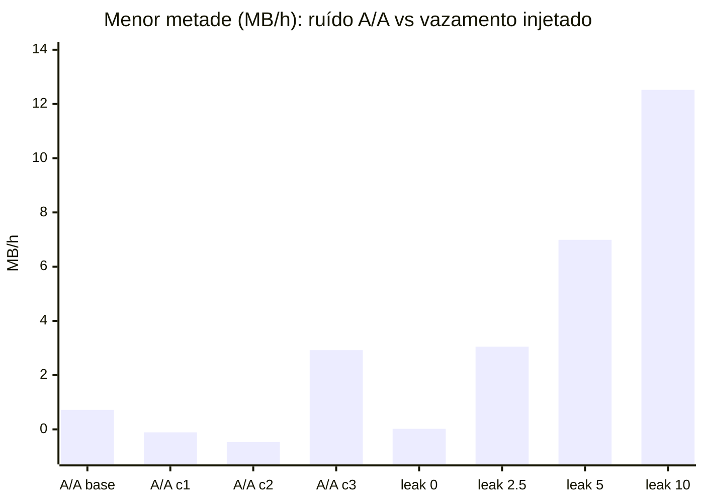

# Relatório de Calibração do Juiz v2 (controle positivo + teste A/A)

- **Data:** 31/10/2026, 10:44 a 12:45 (BRT)
- **Branch / commit:** `fix/juiz-v2` @ `bd0b0ad` ("Juiz v2, fases 0 e 1: controle positivo e travas anti-trapaça")
- **Ambiente:** WSL2 Ubuntu 24.04 (12 vCPUs, 15,5 GB RAM), Python 3.12.3, psutil 5.9.8, Node 22
- **Clone usado:** `~/pesquisa/autoresearch-juiz-v2` (clone limpo, `setup` + `rehash` + `verify: ok 26 arquivos fixos`)
- **App alvo:** `credit-card` (projeto `project-bolt-credit-card.zip` do generated-software-llm)
- **Testes escondidos:** `~/.aging-hidden/hidden_tests.py` (fora do repo, pasta 700). É a **versão antiga**, a mesma que aparece no histórico do git (`31ac544`)
- **Pedido por:** Cesar, antes de qualquer nova campanha (Fase 2 do juiz)

| Rodada | run_id | Duração | Braços |
|---|---|---|---|
| Controle positivo | `control-1031-1044-4c7d` | 60 min + 5 min de aquecimento | baseline + vazamento sintético de 0; 2,5; 5 e 10 MiB/h |
| Teste A/A | `detect-1031-1144-750d` | 60 min + 5 min de aquecimento | 4 cópias idênticas da baseline (`workload_aa.py`) |

> [!NOTE]
> Estas rodadas **não são uma campanha**. Elas não testam hipóteses de carga do agente nem tentam reparar nada. Medem duas coisas: **o ruído do juiz** (A/A) e **a menor taxa de vazamento que ele consegue enxergar em 60 min** (controle positivo). O `run_campaign.sh` não foi executado, como o Cesar pediu.

---

## 1. Como o juiz decide hoje

Em `harness/evaluate.py`, um braço conta como "RSS subindo" (`rss_upward_significant`) quando duas condições valem ao mesmo tempo:

1. o Mann-Kendall dá `p < 0,05` para tendência de alta;
2. o Sen's slope do RSS pós-GC na janela inteira é de pelo menos `MIN_EFFECT_MB_PER_H = 5,0` MB/h.

O juiz também calcula, só como informação, o Sen's slope de **cada metade** da janela (`sen_halves_per_h`) e o menor dos dois (`sen_min_halves_per_h`). A Fase 2 pretende usar essa medida como nota.

---

## 2. Controle positivo: `control-1031-1044-4c7d`

O `harness/leak_inject.js` injeta, por fora da app, um vazamento de memória de taxa conhecida (Buffers, ou seja, memória "externa" do V8). Cada braço roda a carga da baseline do artigo com uma taxa diferente.

| Injetado (MiB/h) | Slope RSS (janela) | 1ª metade | 2ª metade | Menor metade | Externa | Heap | Detectado |
|---|---|---|---|---|---|---|---|
| 0 | 1,10 | 3,12 | 0,02 | **0,02** | −0,00 | 0,18 | não |
| 2,5 | 3,41 | 3,05 | 3,85 | **3,05** | 2,62 | 0,31 | não |
| 5 | 8,69 | 13,35 | 6,99 | **6,99** | 5,24 | 0,33 | **sim** |
| 10 | 13,59 | 12,52 | 15,95 | **12,52** | 10,49 | 0,29 | **sim** |

Inclinações em MB/h. Nos quatro braços: `valid=True`, MK `p ≈ 0`, cerca de 476 a 487 mil requisições, 133 a 137 req/s, p95 mediano de 84 a 91 ms e 1,8% de 5xx (flag `E1`).

**O que mostra:**

- **A injeção funcionou.** A memória externa reproduz a taxa injetada quase exatamente (erro de 0,1 a 0,5 MiB/h), e o heap fica parado. O controle é válido.
- **O juiz atual detecta 5 e 10 MiB/h em 60 min nesta máquina** e não detecta 2,5 MiB/h. Na máquina do Cesar, ele não detectou nem 10 MiB/h. Isso sugere que o ruído depende bastante da máquina.
- O slope da janela inteira **superestima** a taxa injetada em 0,9 a 3,7 MB/h. É a deriva natural da baseline somada ao vazamento.
- A **menor metade** acompanha a taxa injetada de forma monotônica (0 → 3 → 7 → 12,5) e superestima menos.

---

## 3. Teste A/A: `detect-1031-1144-750d`

Quatro processos idênticos, com a mesma carga e a mesma semente, rodando em paralelo. Em tese, todos deveriam dar a mesma inclinação. A dispersão entre eles é o **ruído do juiz**.

| Braço | Slope RSS (janela) | 1ª metade | 2ª metade | Menor metade | RSS início → fim (MB) | Heap | p95 slope |
|---|---|---|---|---|---|---|---|
| baseline_artigo | 2,19 | 15,82 | 0,72 | **0,72** | 106,9 → 112,7 | −0,21 | −2,87 |
| aa_copia_1 | 4,17 | 20,05 | −0,11 | **−0,11** | 103,9 → 111,6 | −0,48 | −6,26 |
| aa_copia_2 | 1,73 | 15,37 | −0,47 | **−0,47** | 106,9 → 112,1 | −0,45 | −0,88 |
| aa_copia_3 | 2,94 | 2,92 | 4,48 | **2,92** | 105,7 → 111,8 | −0,13 | −4,84 |

Nos quatro braços: `valid=True`, cerca de 462 mil requisições, 127 a 128 req/s, 1,9% de 5xx (`E1`), handles estáveis (slope 0) e nenhum processo filho. As três cópias recebem `D4_copia_da_baseline`, como esperado.

**Resumo estatístico (n = 4):**

| Métrica | Média | Desvio-padrão | Mín | Máx |
|---|---|---|---|---|
| Slope RSS (janela) | 2,76 | 1,07 | 1,73 | 4,17 |
| Menor metade | 0,77 | 1,57 | −0,47 | 2,92 |

**O que mostra:**

- **Nenhuma cópia passou do limiar de 5 MB/h**, então não houve falso positivo. Mas a pior cópia (4,17) fica a menos de 1 MB/h do limiar, e média + 2 desvios ≈ 4,9 MB/h. **A margem contra falso positivo é pequena.**
- O ruído está **maior que na A/A de 20/10**, que registrou no máximo 1,2 MB/h (anotado em `evaluate.py`).
- **Em 3 das 4 cópias o RSS sobe na 1ª metade (15 a 20 MB/h) e para na 2ª (≈ 0).** É o perfil de aquecimento e acomodação do alocador: a memória cresce de 5 a 8 MB e se estabiliza. Não é vazamento contínuo. O slope da janela inteira "herda" essa subida inicial; a menor metade não. O braço `leak_0` do controle mostra o mesmo padrão (3,12 → 0,02).
- A exceção é a `aa_copia_3`, que subiu nas duas metades (2,9 e 4,5), mas ainda abaixo do limiar.

---

## 4. Juntando as duas rodadas: onde fica o limiar



| Critério | Pior caso sem vazamento | 2,5 MiB/h | 5 MiB/h | Separação 0 vs 5 |
|---|---|---|---|---|
| Slope da janela (atual) | 4,17 | 3,41 | 8,69 | ≈ 4,5 MB/h, mas o limiar de 5 está colado no ruído |
| Menor metade (Fase 2) | 2,92 | 3,05 | 6,99 | ≈ 4,1 MB/h, e o ruído típico fica perto de 0 |

**Conclusões para a Fase 2:**

1. **O piso de detecção em 60 min nesta máquina é cerca de 5 MiB/h.** Um vazamento de 2,5 MiB/h é indistinguível do ruído nas duas métricas (3,05 contra 2,92).
2. Um limiar **entre 4 e 5 MB/h na menor metade** separa todas as cópias sem vazamento do vazamento de 5 MiB/h, com margem de cerca de 1 a 2 MB/h para cada lado.
3. A menor metade é mais robusta ao aquecimento e a degraus no meio da janela (o problema apontado pelo Cesar) e leva o ruído típico para perto de zero.
4. **O Mann-Kendall não discrimina nada:** dá `p ≈ 0` em todos os 8 braços, inclusive sem vazamento. Quem decide é o tamanho do efeito.
5. **Limitação:** foi uma rodada de cada, com semente única. Para fixar o limiar com confiança, convém repetir o A/A, no mínimo, com outra semente ou em outro horário.

---

## 5. Houve envelhecimento?

**Na janela de 60 min, não há evidência de envelhecimento acima do piso de detecção (cerca de 5 MiB/h).**

| Sinal de envelhecimento | Resultado na baseline (5 braços sem vazamento) | Indica aging? |
|---|---|---|
| RSS pós-GC | Sobe 5 a 8 MB e se estabiliza; slope de 1,1 a 4,2 MB/h, sempre abaixo do limiar | Não conclusivo: a subida é concentrada no início |
| Heap do V8 | Estável ou caindo (−0,48 a +0,18 MB/h) | Não |
| Memória externa | Plana (≈ 0) | Não |
| Handles abertos | Slope 0 | Não |
| Latência p95 | Slope negativo (−0,9 a −6,3 ms/h) | Não: não piorou |
| Throughput | Sem tendência (MK p de 0,06 a 0,8) | Não |
| Erros 5xx | Cerca de 1,8 a 1,9%, constante (`SQLITE_BUSY` sob concorrência, já conhecido) | Problema funcional, não aging |

**Contexto:**

- O artigo relata cerca de 1,5 GB em 50 h para a `credit-card`, uma média próxima de 30 MB/h. Aqui a baseline fica entre 1 e 4 MB/h em 60 min, uma ordem de grandeza abaixo. Há algumas hipóteses, nenhuma confirmada:
  - o crescimento aparece só depois de mais tempo;
  - a configuração de carga do artigo era outra (ver a pendência do JMX com 1 thread contra 10 threads no README);
  - no artigo, cliente e app rodavam em máquinas separadas.
- A campanha anterior, `det-out30` (6 rodadas, 18 hipóteses de carga, resultados em `results/det-out30/`), também **não teve nenhum braço com nota**: nenhuma carga fez o RSS passar do limiar.
- Com o controle positivo, "não achamos aging" passa a ter um significado preciso: **não existe envelhecimento de memória acima de cerca de 5 MiB/h em 60 min** com as cargas testadas. Taxas menores, ou que só aparecem depois de horas, continuam possíveis.

---

## 6. A reparação foi executada?

**Não, e não deveria ser executada agora.**

1. **Não há envelhecimento confirmado para reparar.** A fase de reparo parte de uma carga congelada (`prepare.py freeze`) que faça a app original envelhecer, confirmada com 3 sementes (`prepare.py confirm --phase detect`, sementes 11, 12 e 13). Nem estas rodadas nem a `det-out30` produziram essa carga.
2. **Estas rodadas são de calibração.** Os vazamentos do controle positivo são sintéticos, injetados de fora da app; não existe defeito no código para corrigir.
3. **O Cesar pediu para não rodar campanha** (`run_campaign.sh`) até a Fase 2, porque a nota ainda vai mudar.

Depois da Fase 2, a ordem é: nova campanha de detecção com o critério recalibrado → `freeze` e `confirm --phase detect` → só então `repair-init` e a campanha de reparo.

---

## 7. Arquivos nesta pasta

```
results/calibracao-juiz-v2/
├─ RELATORIO_CALIBRACAO.md      # este relatório
├─ calibracao-juiz-v2.log       # saída completa dos comandos (verify, control, detect)
├─ judge_log.jsonl              # registro do juiz das duas rodadas
├─ control-1031-1044-4c7d/      # controle positivo
│  ├─ round.json                # resultado consolidado (enviar ao Cesar)
│  └─ leak_0 | leak_2.5 | leak_5 | leak_10/
│        evaluation.json, psutil.csv, probe.jsonl, buckets.json, load_summary.json, app.log, app/
└─ detect-1031-1144-750d/       # teste A/A
   ├─ round.json                # resultado consolidado (enviar ao Cesar)
   ├─ workload.py               # cópia do workload_aa.py usado
   └─ baseline_artigo | aa_copia_1 | aa_copia_2 | aa_copia_3/
```

## 8. Para reproduzir

```bash
cd ~/pesquisa/autoresearch-juiz-v2           # fix/juiz-v2 @ bd0b0ad
python3 prepare.py rehash && python3 prepare.py verify
python3 prepare.py control                   # cerca de 65 min
cp workload.py workload_campanha.py && cp workload_aa.py workload.py
python3 prepare.py detect                    # cerca de 65 min
cp workload_campanha.py workload.py
```
